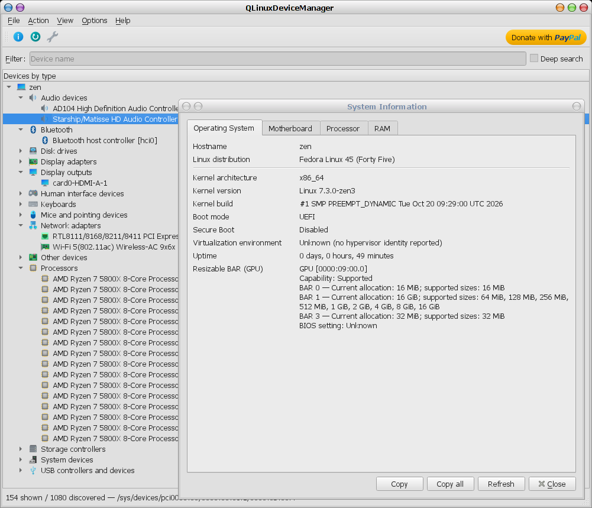

# QLinuxDeviceManager — Linux Device Manager and Hardware Information Viewer

**QLinuxDeviceManager is a lightweight graphical device manager for Linux,
inspired by Windows Device Manager.** Browse your hardware, inspect kernel drivers,
check device properties and view system information in one desktop application.

It works on **X11 and Wayland**, requires no particular desktop environment, and
runs as a normal user. Hardware information stays on your computer; the application
does not upload it.

ACPI/PNP names use an external, replaceable `acpi-pnp.ids` database. See
[database locations and updates](resources/external/device-names/README.md),
including the `--acpi-ids PATH` override.



[More screenshots](SCREENSHOTS.md) ·
[Download an AppImage](https://github.com/birdie-github/QLinuxDeviceManager/releases) ·
[Build from source](doc/implementation.md#build-and-installation)

## What you can see

- **Hardware and drivers:** CPU, GPU, PCI and USB devices, network adapters,
  storage, audio, keyboards, mice, Bluetooth, cameras and batteries. Explore
  devices by type, connection or driver, and inspect assigned hardware resources.
- **System information:** processor models, cores, caches and supported CPU
  features; RAM capacity and memory-device details; motherboard and BIOS/UEFI
  information; Linux version, uptime, Secure Boot and MOK certificates.
- **Network adapters:** IP addresses, MAC addresses, MTU and available Ethernet
  link speed, duplex and supported link modes.
- **Monitors and graphics:** monitor identity and capabilities, display resolution,
  refresh rate, rotation and scale; PCIe link speed and lane width; GPU Resizable
  BAR capabilities and allocated sizes where available. An optional GPU link test
  applies a short graphics load and records the highest observed PCIe link.
- **Storage and drive health:** drive model, capacity and firmware, partitions,
  filesystems and mount points, plus detailed cached ATA SMART attributes and
  NVMe health counters where UDisks2 provides them.
- **USB devices, cameras and batteries:** USB version and connection speed,
  camera formats and resolutions, battery capacity, cycle count and charging status.
- **Live device events:** see devices appear or disappear as you connect or remove
  hardware, and inspect events recorded during the current session.
- **UEFI variables:** browse readable firmware variables and view their raw contents.

Search device names, enable **Deep search** to include identifiers, generic
properties, resources and native storage metadata, and copy information from the
dialogs for troubleshooting or bug reports. Deep search does not cover every
field in specialized hardware tabs.

## Unique features not found in other such applications
- **Shows extended CPU hierarchy and cache configuration**, including CPU groups, i.e.
  performance and efficiency cores,  their maximum frequency, and per-domain caches.
  Sadly, Intel doesn't provide the information  needed to distinguish between efficiency
  cores and low-power efficiency cores.
- **Shows full RAM information**, including manufacturer, performance (speed in MT/s),
  number of modules, whether they are soldered or replaceable.
- **Shows PCI-express devices** link speed, link width, PCIe version standard.
- **Shows USB devices** USB version, bandwidth, voltage, power source, remote wakeup
  capability.
- **Shows full battery status** including presence, status, charge percentage, voltage,
  current, power, number of charge cycles, factory (design) and remaining capacities,
  manufacturer and serial number.
- **Shows storage devices SMART/health status**, including temperature, bytes read
  and written (TBW), available spare, estimated undurance used, power-on time, power
  cycles, number of unsafe shutdowns, SMART errors.
- **Shows Secure Boot status** and default plus enrolled MOK keys.
- **Shows UEFI/BIOS version and date**. Shows whether the system was booted in BIOS
  or EFI mode.
- **Shows whether you're running in a virtual environment**.
- **Includes search/filtering** which allows to instantly view only the devices you
  are interested in.
- **Includes deep search** which allows to search for almost all reported attributes.
- **Allows to browse and view UEFI variables**.
- **Live monitoring** - no need to restart the app to discover newly attached devices.
- **Can show hidden or virtual devices**.

## Download and run on Linux

An **x86_64 AppImage** is available at [the releases](https://github.com/birdie-github/QLinuxDeviceManager/releases).

In the folder containing the extracted AppImage, run:

```sh
chmod +x QLinuxDeviceManager-*.AppImage
./QLinuxDeviceManager-*.AppImage
```

The AppImage includes Qt and support for X11 and Wayland. It is built on Ubuntu
24.04; compatibility with older distributions is not guaranteed. Workflow downloads
expire after 14 days.

If it fails to start because FUSE is unavailable, try:

```sh
./QLinuxDeviceManager-*.AppImage --appimage-extract-and-run
```

To compile and install the application yourself, see the
[build instructions](doc/implementation.md#build-and-installation).

### Distro support

* [Alt Linux package](https://packages.altlinux.org/en/sisyphus/srpms/qlinuxdevicemanager/), maintainer [Nikolay Strelkov](https://github.com/k0ly4n)

## Getting started

Launch the AppImage, or open **QLinuxDeviceManager** from your application menu
if installed. The installed command is `qlinuxdevicemanager`.

1. Expand a category in the device tree and select a device.
2. Press **Enter**, choose **Action → Properties**, or double-click a device
   without children to inspect it. Double-clicking a branch expands or collapses it.
3. Use the **View** menu to switch between hardware, driver and resource views.
4. Open **File → System Information** for an overview of your computer.

| Action | Shortcut or control |
| --- | --- |
| Open system information | **Alt+I** or the leftmost toolbar button |
| Refresh the device list | **F5** |
| Search | **Ctrl+F** |
| Search identifiers, generic properties and resources | **Deep search** in the search bar |
| Clear and close search | **Escape** or toggle **Ctrl+F** |
| Reveal partitions, UEFI variables and internal devices | **View → Show all devices** |
| Update an open device report | **Reload properties** |

The default view hides virtual and internal records to keep the tree easy to
browse. Devices update automatically when hardware changes; use **F5** if you need
to refresh manually. Open Properties dialogs retain a snapshot until you reload
them. System Information has its own **Refresh** and **Copy all** buttons.

### Wireless network details

The Network tab includes a Wireless section for Wi-Fi interfaces. Read-only
nl80211 queries report operating mode, channel/frequency, channel width, transmit
power, and per-direction link rates, signal and spatial streams when the driver
and permissions allow them. Rates are PHY snapshots, not measured throughput;
hotspot rates are per client, so no single hotspot link speed is shown. An adapter
maximum speed is not inferred from its marketing generation or AP advertisements.

Optional QtDBus support uses NetworkManager for the active SSID/BSSID and fallback
link rate/signal quality. The system wpa_supplicant service supplies negotiated
client authentication when accessible; AP security advertisements are not treated
as the selected authentication. Hotspot security uses the active NetworkManager
profile's non-secret key-management setting and is explicitly labeled configured.
Other network backends retain native radio details but may lack connection metadata.
Queries do not request scans, change settings, or retrieve passwords. Restricted
station queries remain explicit permission errors; reload properties for a new snapshot.

Report tables share alternating row colours and manually resizable columns.
All rows are expanded; long or wide reports scroll with their containing page
instead of using nested table scrollbars. Initial column widths are sized once,
and refreshing an existing table preserves manual widths while its columns remain the same.

## Understanding the results

QLinuxDeviceManager is **read-only**: it does not install drivers, change device
settings, mount filesystems or modify firmware variables. Most information is
available without administrator privileges. Restricted or unsupported fields are
shown explicitly; some PCIe connection details require root access.

- **Drive health primarily uses cached UDisks2 information.** For ATA read/write
  counters, optional `smartctl` (smartmontools) is queried in a worker with
  `-j -a -n standby`. This reads SMART data without starting a self-test and requests
  that sleeping drives be skipped; device autodetection can still wake some bridges.
  Raw counters normally require root/sudo or equivalent device permissions. Queries
  have bounded output and a shared timeout. Missing tools, access failures or missing
  counters leave the UDisks2 value visible with a clickable ℹ️ prefix explaining
  its reliability and access limitations. Raw LBA counters are displayed in decimal
  MB assuming 512 bytes per LBA. Tooltips retain the raw counts and explain the
  assumption; vendor-specific counter scales may differ.
  Known UDisks2/libatasmart LBA scaling errors are not presented as actual totals.
  Missing warnings do not guarantee a healthy drive.
- **Reported capabilities are not performance tests.** Link speeds, battery
  capacity estimates and camera modes describe what the system or device reports.
- **Resizable BAR has no universal BIOS on/off indicator.** The application shows
  available capabilities and allocations, and reports the BIOS setting as unknown.
- **Available information varies.** Drivers, permissions, optional libraries and
  desktop protocols affect which fields can be shown. Virtual machines and
  containers may expose a limited or virtual hardware view.
- **Events cover the current session.** They are not a persistent system error log.

## Technical documentation

See the [implementation and build reference](doc/implementation.md) for data
sources, collection limits, detailed interpretation rules, dependencies and
source installation instructions.

## License

QLinuxDeviceManager is free software under the
[GNU General Public License, version 3](LICENSE).
